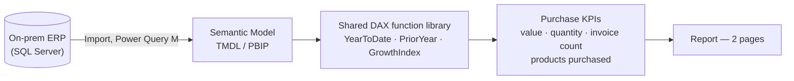

# Purchase Analytics

A **Power BI** procurement-monitoring solution built for a multi-brand FMCG/consumer-
goods distribution business — incoming goods-receipt value, quantity, and
transaction volume from suppliers, by brand, product, and time.

This repository documents the architecture and DAX behind the solution's **Purchase
& Supply** module. It's a portfolio write-up, not the live report: all entity names
in the underlying model are generic sample labels (`Product 001`, `Brand 1`…), and
no real business figures, screenshots, or connection details are included here.

## Business context

The business distributes ~10 brands across roughly 4 divisions, replenished through
regular supplier goods receipts. This module is the buy-side complement to sales
monitoring: how much is coming in, from which brands and products, how that compares
to last year, and how many receiving transactions it took — visibility procurement
and category teams need without cross-referencing supplier paperwork by hand.

## What this covers

- **Purchase value & quantity trend** — monthly and weekly, benchmarked against
  prior year.
- **Transaction volume, tracked as its own KPI** — invoice count and distinct
  products purchased, not just a value/quantity total, since a handful of large
  shipments and many small fragmented receipts carry very different operational
  cost even at the same total value.
- **Brand & product share** — purchase share of total by brand, and product-level
  value/quantity with a YoY growth index.

*Out of scope for this repository:* sales monitoring, inventory, pricing/margin,
trade marketing, sales planning, and portfolio analytics are separate modules in the
full solution — this repo covers incoming goods-receipt tracking only.

## Architecture

## Tech stack

- **Power BI** — authored in [PBIP](https://learn.microsoft.com/power-bi/developer/projects/projects-overview) (TMDL) format for source control
- **DAX user-defined functions** — reuses 3 functions from the solution's shared time-intelligence library (see [DAX Functions Used](docs/dax-functions.md))
- **DAX measures** — purchase value, quantity, transaction, and share KPIs built on that library (see [DAX Measure Catalog](docs/dax-measures.md))
- **Power Query (M)** — SQL Server import and shaping

## Documentation

| Doc | Contents |
|---|---|
| [Data Model](docs/data-model.md) | Star schema, ER diagram, table catalog, relationships, and the transaction-volume design rationale |
| [DAX Functions Used](docs/dax-functions.md) | The 3 shared time-intelligence functions this module calls |
| [DAX Measure Catalog](docs/dax-measures.md) | Purchase value, quantity, transaction-volume, and share measures |
| [Report Tour](docs/report-pages.md) | Walkthrough of both pages |

## Highlights worth a closer look

- **Transactions as a first-class KPI.** Purchase invoice count and distinct
  products-purchased sit alongside value and quantity, not buried in a detail table —
  because receiving-team workload scales with transaction count, independent of
  total purchase value.
- **Consistent time-intelligence, reused, not duplicated.** Every current/prior/YTD/
  growth-index pair composes the same 3 shared functions used across the rest of the
  solution — no separate purchasing-specific date logic to maintain.

## License

[MIT](LICENSE) — this repository (documentation, DAX/architecture write-ups) may be
reused freely with attribution. It does not include the underlying `.pbix`/PBIP
project files, which remain private.

## Author

**Fuad Gashi** — Power BI / Business Intelligence developer.
[GitHub](https://github.com/fuadgashi)
