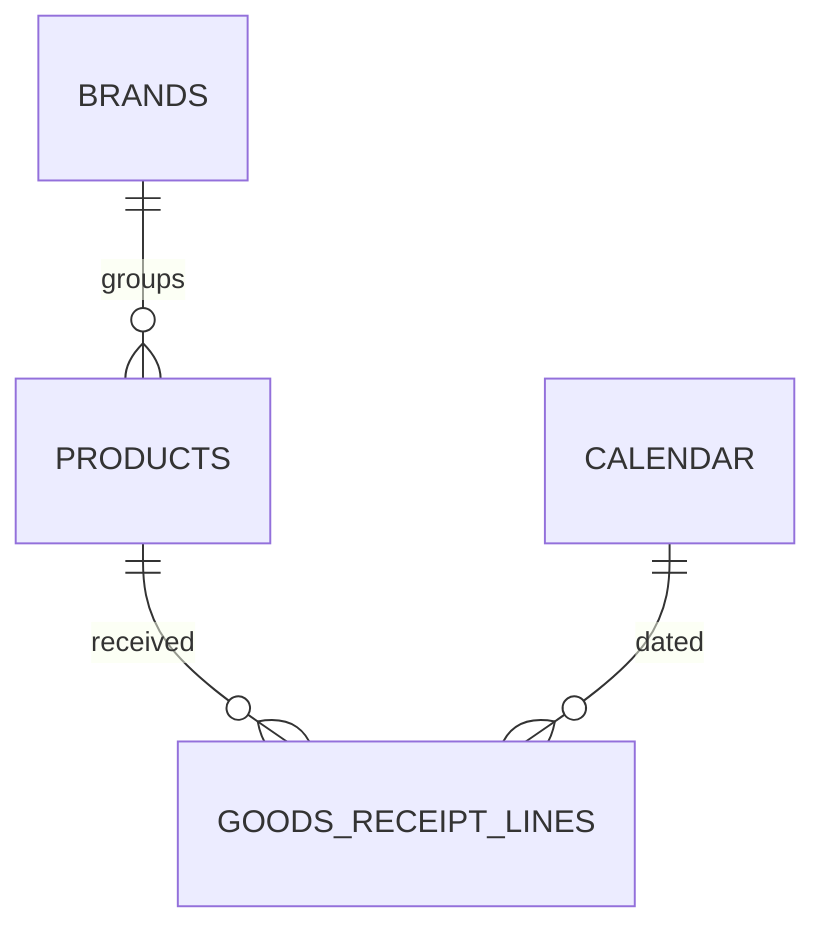

# Data Model

This module is the "buy side" counterpart to sales: how much is being received from
suppliers, of which brands/products, how that's trending against last year, and how
many receiving transactions it took to get there. It's a small, focused star schema —
one fact table hung off the same product/brand/calendar dimensions used elsewhere in
the solution.

## Entity-relationship diagram

## Table catalog

### Dimensions

| Table | Purpose |
|---|---|
| **Calendar** | Date dimension backing every current-year / prior-year / YTD comparison in this module. |
| **Products** | Product master — the grain purchase activity is tracked and ranked at. |
| **Brands** | Brand master (10 brands across 4 divisions) — the grouping level for the purchase-share and brand-comparison visuals. |

### Facts

| Table | Purpose |
|---|---|
| **Goods Receipt Lines** | One row per supplier invoice line received: quantity, supply base price, standard discount %, and extra discount %. This is purchasing/procurement data — it does not touch customer sales, pricing to customers, or stock coverage, which live in separate modules. |

## Relationships

| From | To |
|---|---|
| Products[BrandId] | Brands[Id] |
| Goods Receipt Lines[ProductId] | Products[Id] |
| Goods Receipt Lines[Date] | Calendar[Date] |

## Design note: transactions, not just totals

Alongside value and quantity, this module tracks **purchase invoice count** and
**distinct products purchased** as first-class KPIs, not just a value/quantity pair.
That's deliberate — a buyer needs to know not only *how much* was bought, but whether
it arrived as a handful of large consolidated shipments or many small, fragmented
receiving transactions, since that shapes receiving-team workload independently of
the value on the page.
