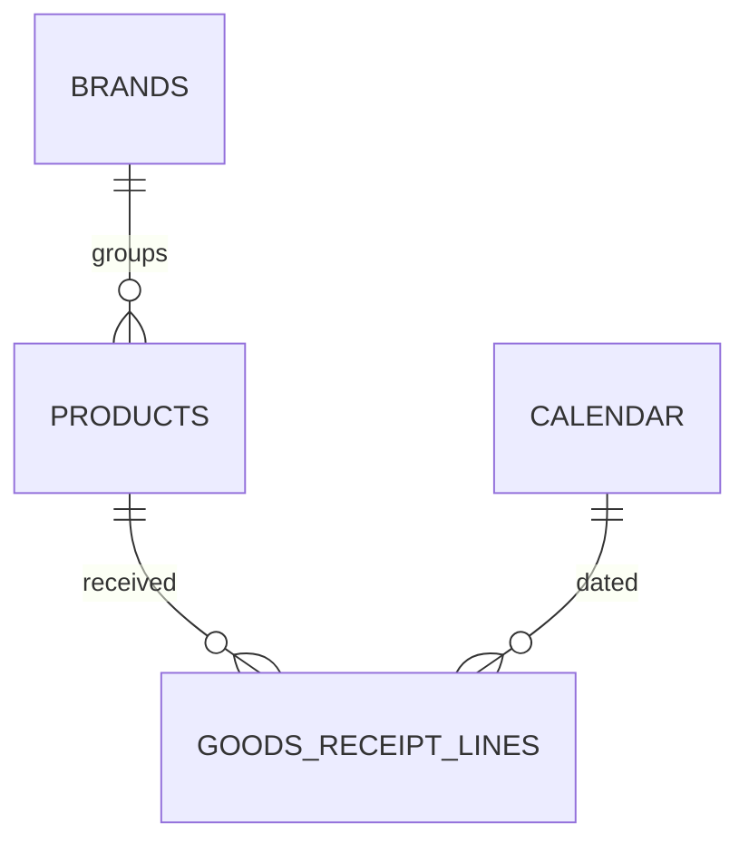

# Data Model

This solution is the "buy side" counterpart to sales: how much is being received from
suppliers, of which brands/products, how that's trending against last year, and how
many receiving transactions it took to get there. It's a small, focused star schema —
one fact table hung off the same product/brand/calendar dimensions used in the
companion Power BI projects.

## Entity-relationship diagram

## Table catalog

### Dimensions

| Table | Purpose |
|---|---|
| **Calendar** | Date dimension backing every current-year / prior-year / YTD comparison in this solution. |
| **Products** | Product master — the grain purchase activity is tracked and ranked at. |
| **Brands** | Brand master (10 brands across 4 divisions) — the grouping level for the purchase-share and brand-comparison visuals. |

### Facts

| Table | Purpose |
|---|---|
| **Goods Receipt Lines** | One row per supplier invoice line received: quantity, supply base price, standard discount %, and extra discount %. This is purchase & supply data — it does not touch customer sales, pricing to customers, or stock coverage, which are covered in separate, standalone projects. |

### Infrastructure (security & localization)

| Table | Purpose |
|---|---|
| **Security** | Row-level-security table — one row per viewer, mapping a UPN to a **role** and a **culture**. Disconnected from the relationship graph; read only through `[User Culture]`. |
| **Labels** | Plain data table — one row per page/visual, per culture, per label role. The source of every piece of user-facing text in the report. Disconnected from the relationship graph. |
| **Dynamic Labels** | Measure-only table hosting one text measure per label, each a lookup against `Labels`. Full reference: [Dynamic Titles & Localization](dynamic-titles.md). |

## Relationships

| From | To |
|---|---|
| Products[BrandId] | Brands[Id] |
| Goods Receipt Lines[ProductId] | Products[Id] |
| Goods Receipt Lines[Date] | Calendar[Date] |

## Row-level security & dynamic localization

Three tables work together to drive a genuinely dynamic, bilingual UI — not two
duplicated sets of pages: `Security` resolves *who* is looking and which culture
they should see (`User Culture = SELECTEDVALUE(Security[Culture], "en-US")`);
`Labels` holds *what* every label says, in every supported culture, keyed by a
`PageKey` band scheme; `Dynamic Labels` holds *the lookup* — one measure per label,
bound into the report through hidden action-button visuals rather than text boxes.

The report ships with **English as the default culture** and **Albanian as a fully
supported secondary culture**. Assign a viewer's row a different `Culture` value and
every page and visual title relabels instantly; adding a third language means adding
rows to `Labels`, not touching a single measure or rebuilding the report.

Full reference — the key scheme, every label family worked through, the exact `fx`
binding, and what changes to add a language: [Dynamic Titles & Localization](dynamic-titles.md).

## Design note: transactions, not just totals

Alongside value and quantity, this solution tracks **purchase invoice count** and
**distinct products purchased** as first-class KPIs, not just a value/quantity pair.
That's deliberate — a buyer needs to know not only *how much* was bought, but whether
it arrived as a handful of large consolidated shipments or many small, fragmented
receiving transactions, since that shapes receiving-team workload independently of
the value on the page.
